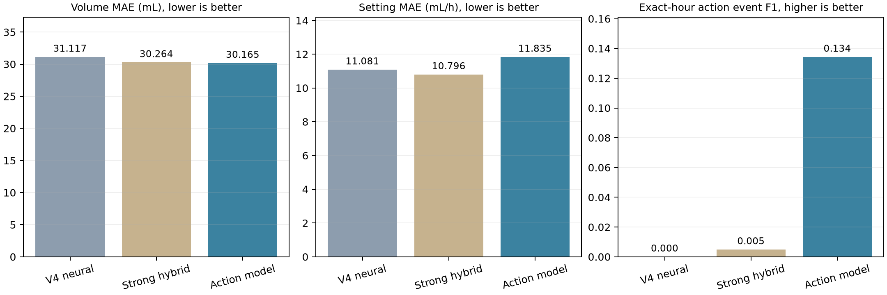

# V6 下一小时补液输入量与文书设置预测实验报告

日期：2026-10-15。对应 issue：[#84](https://github.com/Aveouter/Fluid_Infusion_Decision/issues/84)。对应 PR 将在该 issue 中关联。

本轮解决了旧神经模型“精确时点阈值级变速预测为零”的问题，并提供了生理数值相对记录模式的增量证据。输入量误差相对旧神经模型下降，但总体设置误差上升；既往留出集上，输入量相对强混合基线的优势尚未确立。当前结论是**动作预测取得进展，尚未满足全面替换基线的条件**。

## 1. 任务、输入和参考标签

- 伤后前 72 小时，以小时为预测原点；原点 h=1…71，预测 [h,h+1)。每个原点只读取 k<h 的历史。晶体、胶体、水分别预测。
- 主要输出：下一小时三类输入量（mL）和三类文书设备设置速度（mL/h）。平均输入速度由输入量除以 1 小时另报，不与设备设置速度混为同一标签。
- 输入保留原 V4 静态基线与历史记录：生命体征、记录尿量、既往液体量/设置代理以及伤后时间；静态信息按照入院小时可用性代理开放。人工表是设置参考来源，采用小时起点生效近似，首次已知记录后向前延续；未知不填为零。
- 输入量参考沿用 V4 独立参考规则：排除使用跨患者队列速度先验的全部 16 名患者，保留患者内记录重建的输入量。它不是逐小时实测流量。护理核对、未来完成事件和回顾性标签不作为模型输入。
- 原始患者 449 名；主要输入量参考有效患者 418 名（开发 335、既往留出 83）；设置参考有效患者 362 名（开发 296、既往留出 66）。既往留出原始 90 名患者，本轮有效预测窗口 5,009 个。不同任务按各自有效掩码评估。

本轮没有新增在线泵遥测或真实文书录入延迟。因此严格的历史切片只能保证相对于记录时钟不使用未来字段，不能证明这些字段在临床当时已经可获取。

## 2. 模型和训练方法

V6 是混合估计器：输入量路线明确复用历史强混合模型，并以内层 OOF 选择其与新绝对量/残差树专家的混合；设置路线使用明确的保持/小变化、开启、停止、上调、下调分类及条件幅度专家，分类结果直接控制最终数值输出。不能把其结果解释成旧论文 TCN/Transformer 结构或多任务损失的增益。

V6 对原始记录变量提取末次已知值、距观测时间、末两次记录差和斜率、过去 6 小时均值与记录数；加入历史变速次数/间隔、记录库存与设置的代理。全部只用 k<h，形成 200 个派生数值特征，再附缺失指示。记录尿量趋势与库存代理均不等于实测生理流率/物理库存。没有对原始药液量或设置速度作随机扰动，本轮未引入数据增强。

中位数和分位切点仅在训练患者拟合；固定至多 64 个秩分箱。HGB 固定 100 轮、15 叶、最小叶样本 35、L2=10、学习率 0.07、种子 20261015。患者均衡并叠加类别频率平方根反比权重；本轮是固定种子的树模型实验，不宣称已完成神经模型多随机种子验证。

沿用 V4 的五外折/三内折患者划分。设置阈值仅由内层 OOF 决定：在设置 MAE 不超过来源保持基线 +1 mL/h 的约束下最大化精确小时事件 F1，并处理全部并列风险分数。该内层约束不保证外折或留出集误差不增加。最终权重与阈值用全开发集内层 OOF 确定，在本轮既往留出复核前冻结。

V5b 保留粗网格版本，V5c 改为精确内层阈值搜索；V6 在查看 V5 开发结果后登记状态特征扩展。V6 完整模型按登记方案固定，没有按本轮留出表现挑选组件。登记摘要见 [registered-v6-protocol.json](registered-v6-protocol.json)。这是已查看开发队列上的探索性重建。

## 3. 评估定义

- 输入量和设置 MAE：各液体先计算每名有效患者的平均绝对误差，再患者等权平均，最后三类液体平均；变速小时 MAE 同样患者等权，仅取真实阈值级变化小时。
- 阈值级事件：绝对变化 ≥50 mL/h，或 max(|前值|,|后值|)≥50 且变化比例 ≥25%。保持原阈值。
- 主要动作分数为三类液体各自正类事件 F1 的平均（`action_f1_macro3`），不是五动作类别 MacroF1，也不是活动/非活动 F1。
- 预测与参考均相对于上一有效、连续小时的**文书参考设置**判定变速；缺口不跨越。只在同一目标小时匹配，不使用 ±1 小时容差。该事件分数本身不要求方向一致，方向与动作类别另列汇总。
- 汇总 precision/recall 从三类液体事件计数合并计算，不能据此反推三头平均 F1。由数值输出导出的活动 F1 也与旧网络独立活动头分数分开。
- 患者配对 bootstrap 2,000 次，报告新模型减对照的逐项 95% 区间；MAE 负值、F1 正值有利。本轮区间未作多重比较校正，不作为确认性整体优越性检验。

## 4. 开发集五折 OOF 结果

| 模型 | 输入量 MAE (mL) | 设置 MAE (mL/h) | 精确小时事件 F1 | 变速小时 MAE (mL/h) | 预测 / 命中 / 误报 |
| --- | ---: | ---: | ---: | ---: | --- |
| V6 完整模型 | 30.1645 | 11.8353 | 0.1343 | 87.8594 | 937 / 380 / 557 |
| V4 神经模型 | 31.1169 | 11.0814 | 0.0000 | 97.0492 | 0 / 0 / 0 |
| V4 强混合基线（内层重校准） | 30.2638 | 10.7961 | 0.0049 | 96.7428 | 24 / 12 / 12 |
| 保持上一状态 | 51.2454 | 10.9570 | 0.0000 | 97.0257 | 0 / 0 / 0 |
| V5c 上一迭代 | 30.2193 | 11.9895 | 0.1308 | 88.8889 | 883 / 368 / 515 |

真实阈值级事件共 4,718 个。V4 神经模型预测 0 个、命中 0 个；V6 预测 937 个、命中 380 个、误报 557 个，合并 precision=40.55%，recall=8.05%。因此已排除“严格保持上一状态”的退化解，但多数真实变速仍未识别。

相对 V4 神经模型，V6 输入量 MAE 差值 −0.9523 mL（95%CI −1.4515～−0.5092），动作 F1 差值 +0.1343（0.1179～0.1520），变速小时 MAE 差值 −9.1898 mL/h（−11.0002～−7.4065）；总体设置 MAE 差值 +0.7539 mL/h（0.3608～1.2814）。

相对强混合基线，输入量差值仅 −0.0993 mL（−0.1726～−0.0254），总体设置 MAE 差值 +1.0392 mL/h（0.6473～1.5677）。由数值输出导出的输入量活动 F1 为 0.7907，低于强混合基线 0.8111。不能根据动作分数提高推断全部性能均改善。

[完整指标](development/model_summary.csv) · [配对效应与区间](development/paired_patient_effects.csv) · [各液体设置分数和分母](development/setting_heads.csv)

## 5. 组件贡献与是否只是修复解码

下列对照使用相同训练范围和预算重新拟合设置模块，输入量路线固定。

| 模型 | 输入量 MAE (mL) | 设置 MAE (mL/h) | 精确小时事件 F1 | 变速小时 MAE (mL/h) | 预测 / 命中 / 误报 |
| --- | ---: | ---: | ---: | ---: | --- |
| V6 完整模型 | 30.1645 | 11.8353 | 0.1343 | 87.8594 | 937 / 380 / 557 |
| 仅输液历史 | 30.1645 | 11.7203 | 0.1060 | 89.0684 | 699 / 287 / 412 |
| 仅生理记录模式 | 30.1645 | 11.7336 | 0.1091 | 89.1724 | 723 / 296 / 427 |
| 直接回归设置 | 30.1645 | 11.1264 | 0.0284 | 95.2601 | 201 / 74 / 127 |

| 对照 | V6 事件 F1 增量 | 患者 bootstrap 95%CI | 解释 |
| --- | ---: | --- | --- |
| 仅输液历史 | +0.0282 | 0.0155～0.0408 | 生理记录整体带来增量 |
| 仅保留生理记录模式 | +0.0252 | 0.0134～0.0369 | 保留观测年龄/次数后，生理数值仍有增量 |
| 直接回归设置 | +0.1059 | 0.0873～0.1240 | 动作与数值耦合有贡献，伴随总体 MAE 代价 |
| V5c 原稀疏历史 | +0.0035 | −0.0087～0.0156 | 尚未确立 V6 优于 V5c |

`observation_only` 移除生理数值、差值、斜率和均值，保留年龄和记录数。因此上述结果支持预测增量，不能解释为生理因果效应或临床获益。

V5c 阶段另作旧辅助风险门控对照：使用旧网络风险分数驱动相同新方向/幅度专家，F1=0.0353；V5c 完整模型为 0.1308，配对增量 0.0955（0.0784～0.1132）。这支持改进不只是把旧输出接上解码器。V5c 单小时历史对照 F1=0.0736；额外节律特征的独立增益未成立（完整减去无节律对照 −0.0029，区间 −0.0099～0.0041）。这些是 V5c 阶段结果，不冒充 V6 同版本消融。原始汇总见 [V5c 指标](v5c-development/model_summary.csv) 和 [V5c 配对区间](v5c-development/paired_patient_effects.csv)。

开发集阈值级停止事件支持数为 0；晶体开启仅 1 个、胶体开启 229 个、水开启 4 个。不能宣称全部动作类型均已得到验证。详见 [分方向动作汇总](development/directional_action_types.csv)，head 3/4/5 分别为晶体/胶体/水设置。

## 6. 既往留出集复核

该队列在历史处理中已查看，不能作为全新外部验证。本轮评估前冻结模型，没有据此回调参数。

| 模型 | 输入量 MAE (mL) | 设置 MAE (mL/h) | 精确小时事件 F1 | 变速小时 MAE (mL/h) | 预测 / 命中 / 误报 |
| --- | ---: | ---: | ---: | ---: | --- |
| V6 完整模型 | 25.8218 | 11.4433 | 0.1286 | 84.5789 | 205 / 82 / 123 |
| V4 神经模型 | 27.3386 | 10.7948 | 0.0000 | 93.5507 | 0 / 0 / 0 |
| V4 强混合基线（内层重校准） | 25.8515 | 10.5600 | 0.0056 | 93.4266 | 6 / 3 / 3 |
| 保持上一状态 | 45.2822 | 10.7448 | 0.0000 | 93.5443 | 0 / 0 / 0 |

真实事件 1,048 个，V6 命中 82 个、误报 123 个，合并 precision=40.00%，recall=7.82%。相对 V4 神经模型，输入量 MAE 差值 −1.5168 mL（95%CI −2.5027～−0.6469），动作 F1 +0.1286（0.0964～0.1641），变速小时 MAE −8.9719 mL/h（−11.6939～−6.3497），总体设置 MAE +0.6485 mL/h（0.1212～1.1858）。

相对强混合基线，输入量 MAE 差值 −0.0297 mL（−0.2039～0.2018），**优势未确立**；总体设置 MAE +0.8833 mL/h（0.3508～1.4337）。

[完整指标](historical-holdout/model_summary.csv) · [配对区间](historical-holdout/paired_patient_effects.csv) · [分液体分数](historical-holdout/setting_heads.csv) · [动作类别](historical-holdout/directional_action_types.csv)

## 7. 审稿问题的证据对应

| 问题 | 本轮证据 | 判断 |
| --- | --- | --- |
| 复制上一状态、时间滞后 | 相同精确小时阈值下 0→937 个预测事件，380 个命中；不使用容差匹配 | 零事件退化已修复，召回仍低 |
| 组件有效性 | 重新拟合输液史、记录模式、直接回归对照，生理数值增量区间大于零 | 部分组件有证据，全部组件有效的主张不成立 |
| 性能与强基线 | 输入量/动作/变速小时误差改善；总体速度误差升高；既往留出输入量强基线差值区间跨零 | 未达到全面优于基线 |
| 临床与外推 | 患者分组评估、患者 bootstrap；参考仍为回顾性文书 | 尚无在线泵或独立外部有效性证据 |

本报告关联 #79（生理贡献）、#55（公平基线）、#34（统计支持），不据此关闭这些审稿问题。

## 8. 核验、溯源与交付范围

完成 148 次拟合、146 项训练/评估患者隔离检查及 2 个最终全开发拟合范围核对；11 项针对性测试通过。独立无标签 CLI 用 9 个请求生成 27 行，与保存预测的最大绝对差约 0.00003；发布包维度断言可拒绝错误版本特征入口。发布包装保护在冻结后加入，有效输入数值路径与模型参数未变。

核验汇总见 [audit.json](audit.json)、[release_audit.json](release_audit.json)、[delivery-checks.json](delivery-checks.json)。测试覆盖历史切片、未知不置零、动作到数值耦合、目标扰动隔离、阈值并列、float64 特征一致性和 ±1 小时滞后陷阱。原始特征 SHA256 为 `a1e3af0426ce6493478d75422b9213c2a82b67fb9327d76e7cb77c2043e9fb2f`，冻结源文件指纹见 [frozen-source-hashes.json](frozen-source-hashes.json)。

本次 PR 交付实验报告和聚合结果，不包含训练实现、模型权重、原始记录、患者索引、逐患者误差或逐窗口预测；上述测试是本地完整实现的核验结果，本 PR 自身不能独立复跑训练。保留本地模型与完整溯源供后续代码交付。449 名患者全队列预测含开发/训练患者，不能当作独立验证结果；原默认模型入口未被替换。

本报告内数字可由随附聚合 CSV 复核；文件完整性见 [aggregate-manifest.json](aggregate-manifest.json)。
